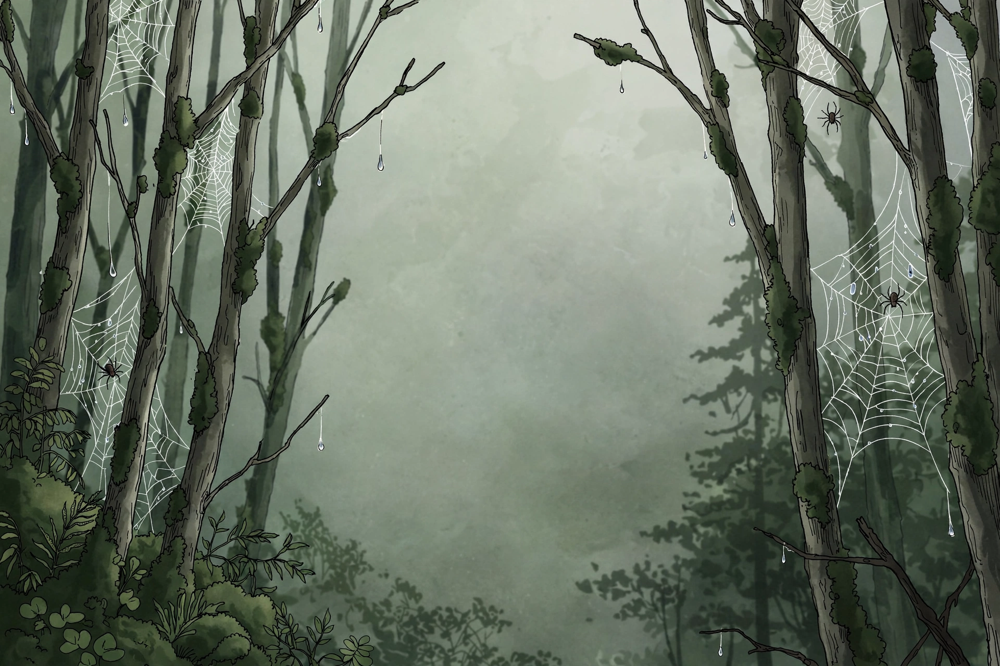

# 🎀 もこブラ（仮名）— 着せ替えできる可愛いブラウザ

**毎日開くブラウザを、好きな世界に着せ替えよう。**
テーマ9種類、ぜんぶ無料のPCブラウザです。

🌐 **公式サイト**: https://tetto03twianac1910-cmd.github.io/mokobura/
⬇️ **ダウンロード**: [最新リリース（v0.1.0）](https://github.com/tetto03twianac1910-cmd/mokobura/releases/tag/v0.1.0) — Mac（Apple Silicon / Intel）/ Windows / Linux 対応、アカウント登録なし

> ⚠️ 現在は開発中の v0.1.0 です。アプリはまだコード署名がないため、初回起動時にOSの確認画面が出ます（Mac: 右クリック→「開く」、Windows:「詳細情報」→「実行」）。正直にお伝えしたうえで、少しずつ育てています。

## テーマは9種類、ぜんぶ無料

気分で選べる9つの世界。選ぶとブラウザ全体の色と新規タブの壁紙がまるごと変わります。

| | |
|---|---|
|  |  |
| 蜘蛛と鬱蒼とした森 — 苔むした暗い森、糸に光る雫、静かな蜘蛛。 | 鹿と暖かな森 — 夕日の木漏れ日、穏やかな鹿、暖色の森。 |
|  |  |
| クジラと深い海 — 深海の静けさ、ゆっくり泳ぐクジラ、泡と光。 | 月と二人だけの宇宙飛行士 — 暗い空、大きな月、二人だけの静かな宇宙。 |
|  |  |
| 都会の大人可愛い女子の日常 — 静かな都会、カフェと本と夕方。 | ゲーム女子とレトロなネオン空間 — レトロゲームの光、ネオンの部屋。 |

残りのテーマもアプリの中で見られます。

- 温かみのある和風な日本庭園
- 大胆な配色（mikapijazo風）
- あなただけの美少女恋人

画風は全テーマで統一しています。クリアな線、色数を絞って、余白を大事に。

## 特徴

- **着せ替え**: テーマを選ぶだけで、タブ・アドレスバー・新規タブページまで一括で着せ替え。設定は自動で保存されます
- **普通に使えるブラウザ機能**: タブ、履歴（端末内に最大500件）、ブックマーク（☆ボタン）、新規タブページには時間帯のあいさつ・検索窓・ショートカット
- **完全無料**: テーマは全て無料。課金・サブスクなし
- **広告はアプリ内に入りません**: 広告を載せる場合も公式サイトのみ、世界観に合うものだけを想定しています
- **サーバーなし・ログインなし**: 履歴もブックマークもあなたのPCの中だけに保存されます

## フィードバック募集中 🙏

使ってみた感想、「こんなテーマがほしい」、不具合の報告など、どんな小さなことでも歓迎です。
[Issues](https://github.com/tetto03twianac1910-cmd/mokobura/issues) からお気軽にどうぞ。いただいた声は次の改善に使います。

気に入ったら ⭐ をつけてもらえると、とても励みになります。

---

## 開発者向け

Simejiがキーボードに可愛さを足したように、ブラウザに「着せ替え」を足す、という発想のプロジェクトです。

### 方針（2026-11-21 決定）
- 対応は **PC版のみ**（Windows / Mac / Linux）、**完全無料**。課金・サブスクなし。
- テーマは **9種類、全て無料**（`src/themes/themes.js` が定義の単一ソース）。
- 収益源は当面なし。広告は **公式サイトのみ**、世界観に合う可愛い広告を厳選掲載する想定（アプリ内広告なし）。
- 表示エンジンは Electron 内蔵の Chromium。自前エンジンは持たない。
- サーバーなし / ログインなし / 公式テーマのみ → 運用はほぼ自動化できる設計。

### 動かし方（開発用）
```bash
npm install   # Electron を取得（初回のみ、要ネット）
npm start     # アプリ起動
npm run check # 構文チェックだけなら install 不要 (node のみ)
```

### 構成
- `src/main.js` — タブ管理（WebContentsView）、設定保存、IPC
- `src/preload.js` — レンダラへ渡す安全なAPI
- `src/renderer/` — ブラウザの外側UI（タブバー、アドレスバー、テーマクローゼット）
- `src/themes/themes.js` — 9テーマの配色・説明（単一ソース）
- `src/themes/assets/wallpapers/` — テーマ壁紙
- `docs/index.html` — 公式サイト（GitHub Pages で公開、広告枠つき）
- `docs/growth/` — 集客戦略と投稿下書き
- `THEME_SPEC.md` — デザイン生成AI向けの制作仕様

### 進捗
- [x] 9テーマの壁紙イラスト生成 — 9/9 完了（`src/themes/assets/wallpapers/`）
- [x] 新規タブページ（テーマ壁紙＋あいさつ＋検索＋ショートカット、テーマ連動）
- [x] 履歴・ブックマーク（端末内保存、☆で登録、📚パネルから再訪・履歴消去）
- [x] 配布用パッケージング設定（electron-builder、Win: nsis+portable / Mac: dmg / Linux: AppImage）
- [x] v0.1.0 を GitHub Releases で公開（Win ポータブル / Mac dmg（Apple Silicon・Intel）/ Linux AppImage・tar.gz）。ただし署名なし
- [x] 公式サイトを GitHub Pages で公開、ダウンロード導線あり
- [ ] コード署名（Mac公証は Apple Developer $99/年、Windowsは署名証明書）
